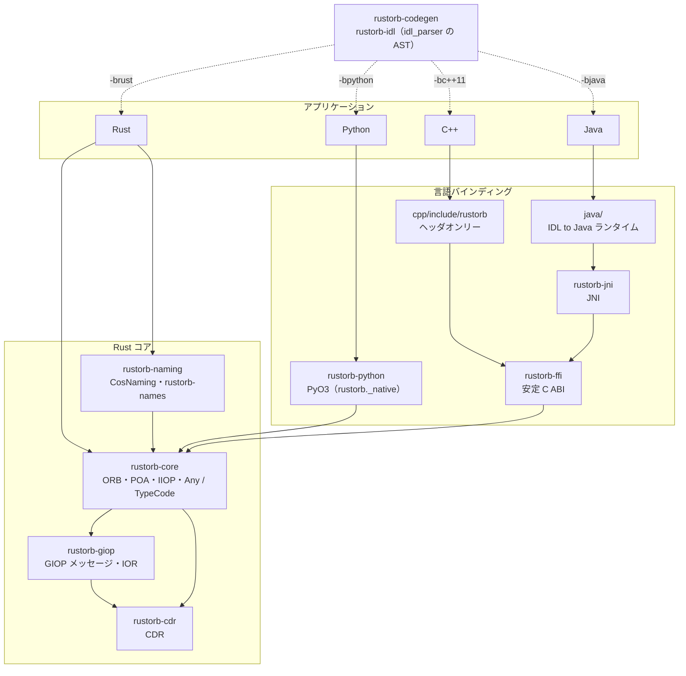
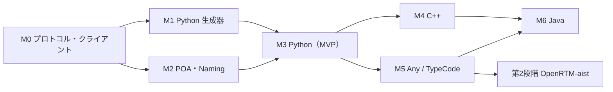

# Rust製CORBA ORB 開発計画

Oct 28, 2026 · @ysuga

## 目的とスコープ

omniORBを置き換えられる、コアを純Rustで実装したCORBA ORBを作る。最初の到達点は「omniORB/omniORBpyの一般的な用途（Naming Service経由の呼び出し・サーバー公開）をPythonから置き換えられるMVP」とする。

**対象**

- GIOP 1.2 / IIOP（クライアント・サーバー双方）、CDRエンコード
- IOR、corbaloc、corbaname
- POA（RootPOA＋主要ポリシー）、サーバントの登録と活性化
- CosNaming（NamingContext / NamingContextExt / BindingIterator）とNaming Serviceデーモン
- IDL生成：Rust、Python、C++（CPP11準拠）、Java

**当面の対象外**（後続フェーズで判断）

- CORBA Component Model、Event / Notification Service
- Interface Repository、DII / DSI
- SSLIOP、CSIv2 などのセキュリティ
- 旧来のIDL to C++（C++98）マッピング

## 準拠する仕様

C++はIDL to C++11（CPP11）を基準にし、IDL4-CPPで追加された構文は必要に応じて取り込む。Rustは公式マッピングがまだないため独自定義とし、OMGのIDL4-Rust RFPの動向を追う。

| 領域 | 仕様 | 方針 |
| --- | --- | --- |
| コア | CORBA 3.x（GIOP 1.2 / IIOP / CDR） | GIOP 1.0〜1.2を受け付け、送信は1.2 |
| ネーミング | CosNaming（Naming Service） | NamingContextExt まで対応 |
| Rust | 独自マッピング | [IDL4-Rust RFP](https://www.omg.org/gettingstarted/rfp-IDL4-RLP.htm) の動向に追随 |
| C++ | [IDL to C++11](https://www.omg.org/spec/CPP11/Current)（v1.7） | 基準。実装・生成コードはC++17を使用 |
| C++（IDL4） | [IDL4-CPP](https://www.omg.org/spec/IDL4-CPP)（v1.0） | アノテーション・拡張型を順次取り込み |
| Python | IDL to Python マッピング | 標準マッピングとomniidlの生成レイアウトは互換、omniORBpy独自拡張は厳選して互換シムで提供 |
| Java | IDL to Java マッピング | 生成APIは標準準拠、実装はRustコア経由 |

## 全体アーキテクチャ

プロトコル実装はRustコアの4クレートに集約し、各言語はその上に薄く載せる。IDLからのコード生成は、既存のidl\_parserのASTを入力にする生成器クレートが担う。

実線は実行時の呼び出し、破線はビルド時のコード生成。C++とJavaは安定C ABI層を経由し、PythonはPyO3でコアを直接呼ぶ。

## マイルストーン

M0〜M3の約4〜7か月でMVPに到達し、その後C++とJavaを順に追加する。各マイルストーンは、既存ORBとの相互接続で完了を判定する。

| | 内容 | 完了条件 | 実績 |
| --- | --- | --- | --- |
| M0 | CDR・GIOP、IOR・corbaloc、IIOP クライアント、CosNaming クライアント、相互接続環境、idl\_parser の不足の洗い出し | rustorb のクライアントから omniORB C++ / omniORBpy のサーバーを omniNames 経由で呼べる | [#14](https://github.com/rustorb/rustorb/pull/14)〜[#20](https://github.com/rustorb/rustorb/pull/20) |
| M1 | Python 生成器 `rustorb-idl -bpython` | omniidl -bpython と同じ公開 API の生成物になる | [#25](https://github.com/rustorb/rustorb/pull/25) |
| M2 | POA・サーバー側、Naming Service デーモン `rustorb-names` | omniORB の POA と同じプローブ結果になり、omniORB / omniORBpy のクライアントから呼べる | [#21](https://github.com/rustorb/rustorb/pull/21)〜[#24](https://github.com/rustorb/rustorb/pull/24) |
| M3 | Python バインディング（PyO3）：MVP | omniORBpy のクライアント・サーバーの import を替えただけで動く | [#26](https://github.com/rustorb/rustorb/pull/26) |
| M4 | C++ バインディング（C ABI、IDL to C++11、`-bc++11`） | omniORB C++・omniORBpy・rustorb とのすべての組み合わせで通る | [#27](https://github.com/rustorb/rustorb/pull/27) |
| M5 | Any / TypeCode | `--suite any` がすべての組み合わせで通る。続けて OpenRTM-aist との接続（第2段階） | [#28](https://github.com/rustorb/rustorb/pull/28)、[#29](https://github.com/rustorb/rustorb/pull/29)（第2段階は [#30](https://github.com/rustorb/rustorb/pull/30)、[#31](https://github.com/rustorb/rustorb/pull/31)） |
| M6 | Java バインディング（JNI、`-bjava`） | JacORB を含むすべての組み合わせで通る | [#32](https://github.com/rustorb/rustorb/pull/32) |

M0〜M6 はすべて完了した。その後の作業は issue で管理している（「[残りの issue](#残りの-issue)」）。

期間は1人で進める前提の目安。M4とM5はM3完了後なら並行して進められる。

## 言語バインディング設計

各言語はRustコアの上に薄く載せ、プロトコル実装は持たない。共通の設計課題は、オブジェクト参照のライフタイム、例外の変換、サーバント呼び出し時のスレッドの扱いの3点。

| 言語 | FFI手段 | 生成されるもの | 主な課題 |
| --- | --- | --- | --- |
| Python | PyO3 + maturin | スタブ・スケルトンのPythonモジュール、型ヒント（.pyi） | GILとORBスレッドの協調、omniORBpy互換API |
| C++ | C ABI（安定ABI層）＋ヘッダオンリーのC++ラッパ | CPP11準拠のヘッダ・スケルトン | RAIIと参照カウントの対応、例外の伝播 |
| Java | JNI（将来Java 22以降のFFM APIも検討） | IDL to Java準拠のクラス群 | JavaのGCとRust側参照の解放、コールバックのスレッドアタッチ |

- Rustコアは`extern "C"`の安定ABI層（`rustorb-ffi`）を1つだけ公開し、C++とJavaはそこから使う。Pythonは開発効率を優先してPyO3で直接つなぐ
- オブジェクト参照はRust側で参照カウントし、各言語のハンドルが解放されたら減算する
- 例外はシステム例外・ユーザー例外ともにCDRで表現し、各言語の例外クラスに変換する

## テストと相互接続検証

完了の判定は「既存ORBとの相互接続テストが通ること」を基準にする。単体テストだけでは非互換を見落とすため、早い段階からCIに組み込む。

1. **単体テスト**：CDRのエンコード・デコード（境界アラインメント、エンディアン、ネスト型）、IOR・corbalocのパース
2. **ゴールデンテスト**：omniORBが送受信したGIOPメッセージのキャプチャを保存し、バイト列単位で比較
3. **相互接続マトリクス**：自作ORBとomniORB / omniORBpy / JacORB を、クライアント・サーバーの両方向で組み合わせて実行
4. **Naming Service互換**：omniNamesと同じ操作列（bind、rebind、resolve、list、unbind）を両方に流して結果を比較
5. **ファジング**：cargo-fuzzでGIOPメッセージ・CDRデコーダを常時ファジング
6. **負荷・長時間試験**：同時接続数、リクエストレート、接続断と再接続、メモリリーク（[load-testing.md](load-testing.md)）

相互接続テストはDockerで各ORBの環境を用意し、GitHub Actionsで毎回回す。

### 相互接続の優先順位

最初の置き換え対象は2段階で決める。MVP（M0〜M3）は「Naming Service経由の汎用的なPython呼び出し」で完了を判定し、Any / TypeCode を実装するM5の完了後に「OpenRTM-aist-Pythonの動作」を次の完了条件にする（[#7](https://github.com/rustorb/rustorb/issues/7)）。OpenRTM-aistはSDOのプロパティ（NVList、値が any）やデータポートのCDR直列化を使うため、最初から対象にするとAnyをMVPへ前倒しすることになるので、段階を分ける。

**第1段階：Naming経由の汎用Python呼び出し（MVPの完了条件）**

| 優先度 | クライアント | サーバー | ネーミング |
| --- | --- | --- | --- |
| 1 | rustorb（Python） | omniORBpy | omniNames |
| 1 | omniORBpy | rustorb（Python） | omniNames |
| 1 | omniORBpy・rustorb（Python） | 両方 | rustorbのNaming Service |
| 2 | rustorb（Python・Rust） | omniORB（C++） | omniNames |
| 2 | omniORB（C++） | rustorb（Python・Rust） | omniNames |
| 3 | rustorb ⇔ JacORB（両方向） | | Javaバインディング（M6）で追加。Java・C++・Python・Rust の rustorb と JacORB のすべての組み合わせ |

- **題材のIDL**：自作の小さなテスト用IDLと CosNaming.idl を使う。テスト用IDLは基本型、string / wstring、struct、enum、union、sequence、配列、typedef、ユーザー例外、属性、oneway、オブジェクト参照の受け渡し、コールバック（サーバーからクライアントへの呼び返し）を含め、Anyは含めない
- **ゴールデンテスト**：同じテスト用IDLで omniORBpy・omniORB が送受信するGIOPメッセージをキャプチャし、比較の基準にする
- **Naming Service**：rustorbのNaming Serviceに omniORBpy と omniORB から bind・resolve・list を行い、omniNamesと同じ結果になることを確認する

**第2段階：OpenRTM-aist-Python（M5完了後の完了条件）**

- **組み合わせ**：互換シム経由で rustorb 上に載せた OpenRTM-aist-Python のRTCと、omniORB上の OpenRTM-aist（C++）のRTCを、データポートとサービスポートで両方向に接続する。ネーミングは omniNames と rustorb のNaming Service の両方で確認し、rtshell など既存ツールからの状態遷移（activate / deactivate）も通す
- **題材のIDL**：OpenRTM-aist の RTC.idl、SDOPackage.idl、DataPort.idl（CORBA\_CdrDataPort）、Manager.idl など、RTCの通信に使うIDL一式
- **互換シムの洗い出し**：OpenRTM-aist-Pythonが実際に呼ぶomniORBpy独自API（`cdrMarshal` / `cdrUnmarshal`、タイムアウト設定、例外ハンドラなど）をこの段階で確定し、互換シムに入れる範囲を決める

## 非同期ランタイムとスレッドモデル

通信I/Oは内部のtokioで処理し、サーバント呼び出しはORB専用のスレッドプールに渡す。I/Oとアップコールを分けるのは、Python・Java・C++のサーバントがすべてブロッキング処理で、tokioのワーカー上で呼ぶとI/O全体が止まるため。

- **I/O層**：rustorb-core が内部でマルチスレッドのtokioランタイムを持ち、接続の受け付け、GIOPメッセージの送受信、リクエストの多重化を担う。既存のtokioランタイムを使いたい利用者向けに、ハンドルを渡して共有する手段も用意する
- **アップコール層**：デコード済みのリクエストを、長寿命のOSスレッドからなるプールに渡してサーバントを呼ぶ。プールの上限は設定可能にする（omniORBの maxServerThreadPoolSize に相当）
- **クライアント呼び出し**：同期APIは結果をチャネルで待つ実装にし、tokioのコンテキスト外からも、アップコール中のスレッドからも呼べるようにする。サーバント内からの入れ子呼び出しやコールバックで、プールが枯渇しないよう上限と待ち合わせを設計する
- **言語バインディングとの協調**：プールのスレッドは入れ替わらないため、JNIの AttachCurrentThread はスレッドごとに1回で済み、Pythonはサーバント呼び出しの間だけGILを取得する
- **omniORBとの突き合わせ**：実測では omniORB も同じ接続の要求（onewayを含む）を並行に処理し、順序を保証しない。そのため接続ごとの順序保持オプションはMVPでは設けず、順序が必要な場合は omniORB と同じく SINGLE\_THREAD\_MODEL を使う。POA・接続処理・言語バインディングからの呼び出し・`ORB::run` / `shutdown` の設計と実測結果は [poa-design.md](poa-design.md) にまとめた

## omniORBpyとの互換範囲

omniORBpyの既存コードを、少ない書き換えで動かせることを目標にする。互換は3層に分け、標準部分は完全互換、独自拡張は実際に使われているものだけを取り込む。

- **標準マッピング（完全互換）**：OMGのIDL to Pythonマッピングに従う部分。`CORBA.ORB_init`、`resolve_initial_references`、`PortableServer`（POA・POAManager・ポリシー）、`CosNaming`、システム例外・ユーザー例外のクラス階層、`_narrow` / `_this`、構造体・列挙・シーケンス・ユニオンのPython表現を、omniORBpyと同じ挙動にする
- **生成コードのレイアウト（互換）**：IDLコード生成器は omniidl -bpython と同じ構成（`Module` / `Module__POA` パッケージと `xxx_idl.py`）を出力し、既存の `import` 文をそのまま使えるようにする。加えて型ヒント（.pyi）を生成する
- **omniORBpy独自拡張（厳選して互換）**：`omniORB` パッケージ名で提供される独自APIのうち、よく使われるものを互換シムとして用意する。候補は `cdrMarshal` / `cdrUnmarshal`、`setClientCallTimeout` などのタイムアウト設定、TRANSIENT等の例外ハンドラ登録、`omniORB.any` のAny変換ヘルパ。対象はOpenRTM-aist-Pythonなど実際のアプリで必要なAPIを洗い出して決め、使われていないものは入れない
- **パッケージ構成**：本体は `rustorb` パッケージ（`from rustorb import CORBA, PortableServer`）。`from omniORB import CORBA` を通す互換シムは、本物のomniORBpyと同じ環境に入れても衝突しないよう、別パッケージとして任意でインストールする形にする
- **対象外**：omniORBpy内部の実装モジュール（`_omnipy` など）、omniORB固有の設定ファイルとすべての設定パラメータの再現。ORB初期化引数（`-ORBInitRef`、`-ORBendPoint` など）は主要なものだけ受け付ける
- **検証**：既存のomniORBpyアプリとテストを、互換シム経由でrustorb上で動かすことを相互接続テストに加える。動かなかったAPIは互換シムへの追加を検討する

## Naming Serviceの永続化

Naming Serviceは、保存先をトレイトで抽象化し、既定の実装はomniNamesと同じ「追記ログ＋チェックポイント」方式にする。ネーミングのデータは小さく書き込みもまれで、KVSの性能上の利点が小さいため、依存のない単純な方式を選ぶ。

- **保存層の抽象化**：bind・rebind・unbind・コンテキストの生成と破棄を記録する保存トレイトを定義し、Naming Serviceの本体はこのトレイトだけに依存する。永続化しないインメモリ実装も用意し、テストと一時利用に使う
- **既定実装（追記ログ＋チェックポイント）**：更新操作を1件ずつログファイルに追記し、応答を返す前にfsyncする。一定の操作数または時間ごとに全状態をチェックポイントとして一時ファイルに書き出し、renameで置き換えてからログを切り詰める。起動時はチェックポイントを読み込み、続けてログを再生する。末尾の書きかけのレコードは破棄する
- **ファイル形式**：1行1レコードのテキスト形式にし、名前とオブジェクト参照（文字列化IOR）を人が読める形で残す。先頭に形式のバージョンを書き、将来の変更に備える
- **参照の永続性**：再起動後も同じIORで引けるよう、各NamingContextはPERSISTENTなPOAで固定のオブジェクトキーを持ち、デーモンは固定ポートで待ち受ける（omniNamesの `-start` に相当）。ルートコンテキストのオブジェクトキーは `NameService` とし、`corbaloc::host:port/NameService` で引けるようにする
- **KVS**：組み込みKVS（純Rustのredbを想定）は、規模や要件から必要になった時点で、機能フラグ付きの別実装として追加する。MVPには含めない
- **対象外**：omniNamesのログファイルの読み込み・移行はMVPでは対象外とする

## リスクと対策

最大のリスクは、POAとスレッドモデルの設計を誤って後から作り直しになること。M2の前に設計レビューを挟んで抑える。

| リスク | 影響 | 対策 |
| --- | --- | --- |
| POA・スレッドモデルの設計ミス | サーバー側全体の作り直し | M2着手前に設計書を作り、omniORBの挙動と突き合わせる |
| 既存ORBとの細かい非互換 | 実運用で接続できない | ゴールデンテストと相互接続マトリクスを最初からCIに入れる |
| 言語間のオブジェクト参照の寿命管理 | メモリリーク、解放済み参照の利用 | 参照カウントをRust側に一元化し、各言語のテストでリークを検出 |
| Any / TypeCode の実装負荷 | MVPの遅れ | MVPから外し、M5に回す |
| idl\_parser の拡張が必要になる | コアとパーサの並行改修 | M0でAST上の不足を洗い出し済み（[idl-parser-gap-analysis.md](idl-parser-gap-analysis.md)）。P0の5件をM1の前に直す |
| 4言語の保守負担 | 進捗の分散 | Pythonを先行させ、C++・Javaはコア安定後に着手 |

## 未決事項と次のアクション

**決定事項**

- プロジェクト名は rustorb。クレート名は `rustorb-` を接頭辞にする（例：`rustorb-core`、`rustorb-ffi`）（[#2](https://github.com/rustorb/rustorb/issues/2)）
- ライセンスは MIT OR Apache-2.0 のデュアル。ただし、GPL-3.0-or-later の idl\_parser を取り込むIDLコード生成器だけは GPL-3.0-or-later とし、生成されたコードは生成器のライセンスの対象外とする（[#2](https://github.com/rustorb/rustorb/issues/2)）
- 非同期ランタイムは tokio に固定する。ただしランタイムはORB内部に閉じ込め、公開APIは同期APIを基本にして、利用者にtokioを要求しない。async APIは任意で追加する（[#3](https://github.com/rustorb/rustorb/issues/3)）
- POAのデフォルトスレッドモデル（ORB\_CTRL\_MODEL）では、サーバント呼び出しをtokioのワーカーとは別の、ORB専用の長寿命OSスレッドプールで実行する。SINGLE\_THREAD\_MODEL（POAごとの直列化）と MAIN\_THREAD\_MODEL（`orb.run()` のスレッドで実行）は、このプールの上にキューを足して実現する（[#4](https://github.com/rustorb/rustorb/issues/4)）
- Pythonバインディングは、OMGのIDL to Python標準マッピングと omniidl -bpython の生成レイアウトを omniORBpy と互換にし、omniORBpy独自拡張は実アプリで必要なものだけを別パッケージの互換シムで提供する（[#5](https://github.com/rustorb/rustorb/issues/5)）
- Naming Serviceの永続化は保存先をトレイトで抽象化し、既定実装はomniNamesと同じ追記ログ＋チェックポイント方式とする。組み込みKVSは必要になった時点で機能フラグ付きで追加する（[#6](https://github.com/rustorb/rustorb/issues/6)）
- 最初に置き換える用途は2段階とし、MVPはNaming Service経由の汎用的なPython呼び出し（omniORBpy・omniNamesとの相互接続を最優先）、M5（Any / TypeCode）の完了後はOpenRTM-aist-Pythonの動作を完了条件にする（[#7](https://github.com/rustorb/rustorb/issues/7)）
- 既存ORB（omniORB / omniORBpy / JacORB など）との互換は、仕様と実行結果（生成されたIOR、GIOPキャプチャ、相互接続テスト）だけを根拠に取る。コアは寛容ライセンスのため、既存ORBのソースコードは読まない。挙動を合わせる場合は、実際に動かした結果をテストのフィクスチャにする（[#17](https://github.com/rustorb/rustorb/pull/17)）

**未決事項**

- POA・スレッドモデル設計書（[poa-design.md](poa-design.md)）のレビュー（[#4](https://github.com/rustorb/rustorb/issues/4)）

**次のアクション**

- [x] idl\_parser のリポジトリを共有し、ASTの構造と不足を確認する（[idl-parser-gap-analysis.md](idl-parser-gap-analysis.md)）
- [x] Cargoワークスペースの雛形とクレート分割を作る
- [x] omniORBとomniORBpyの相互接続テスト環境（Docker）と、第1段階のテスト用IDLを用意する（[interop/](../interop/README.md)）
- [x] CDRエンコーダとGIOPメッセージ型の実装に着手する（`rustorb-cdr`、`rustorb-giop`、cargo-fuzzターゲット）
- [x] IOR（IIOPプロファイルとタグ付きコンポーネント）、corbaloc・corbanameのパースを実装する（`rustorb-giop`）
- [x] 相互接続環境のキャプチャで、GIOP 1.2のBOMなしwstringのバイト順（仕様はビッグエンディアン）と、GIOP 1.1のFragmentのアラインメントをomniORBと突き合わせる（[interop/README.md](../interop/README.md#omniorb-wire-format-findings)）
  - wstring：omniORBは空でなければ常にBOM付き・ストリームのバイト順で送り、BOMなしはビッグエンディアンとして読む（キャプチャと `interop/run-wire-probe.sh` による実測）。wcharは常にビッグエンディアン・BOMなし。rustorbの送信もBOM付きに合わせた（`Encoder::set_wstring_bom(false)` で仕様どおりのBOMなしビッグエンディアン）
  - GIOP 1.1 Fragment：omniORBは各Fragmentのデータを、そのFragmentの先頭を基準にアラインメントする。連結したメッセージ基準とは8バイト境界が4バイトずれるため、`FragmentAssembler` はFragmentごとの区切り（`Segment`）を保持して復号する。GIOP 1.2では両者は一致する
- [x] `rustorb-core` にIIOPクライアントを実装し、omniORB C++ / omniORBpy サーバーへの呼び出しを相互接続環境で確認する（`interop/impls/rustorb`、手書きスタブ）
  - ORB初期化（`-ORBInitRef`、`-ORBDefaultInitRef` など）、エンドポイントごとの接続プール、GIOP 1.0〜1.2 のRequest/Reply・LocateRequest、システム例外・ユーザー例外、`LOCATION_FORWARD`（転送先に届かなければ元のIORに戻る）、`NEEDS_ADDRESSING_MODE`、代替アドレス、`CloseConnection` 後の再送、タイムアウトと `CancelRequest`、`string_to_object`（IOR、corbaloc、`corbaloc:rir:`）
  - コードセットはIORのコンポーネントから交渉する（rustorbのネイティブは `char` がUTF-8、`wchar` がUTF-16。`char` はISO 8859-1へ変換できる）。omniORBのIORは `char` がISO 8859-1でUTF-8へ変換可、`wchar` がUTF-16のため、UTF-8とUTF-16が選ばれる
  - 相互接続：コールバックの2ケース（POAが必要）を除く76ケースが通る。失敗は既存の `known-failures.txt` の範囲（omniORBpyのwchar受信、GIOP 1.1のwchar）だけ
- [x] CosNamingのクライアント（`rustorb-naming`）と `corbaname:` を実装する
  - `NamingContext` / `NamingContextExt` / `BindingIterator` の手書きスタブと、ユーザー例外（`NotFound`、`CannotProceed`、`InvalidName`、`AlreadyBound`、`NotEmpty`、`InvalidAddress`）。宣言されていないユーザー例外は `UNKNOWN` にする
  - 名前の文字列形式（`to_name` / `to_string`）と `NameComponent` は `rustorb-core` の `name` モジュールに置き、`Orb::string_to_object` が `corbaname:` を自分で解決する（`NamingContext::resolve` を呼ぶ）。名前を省略すると命名コンテキスト自体を返す
  - omniORBの実測に合わせた例外：名前が見つからなければ `BAD_PARAM`（minor 10、`STRING_TO_OBJECT_OTHER`）、名前の形式が不正なら `BAD_PARAM`（minor 9、`BAD_SCHEME_SPECIFIC_PART`）、命名サービスのシステム例外はそのまま
  - 相互接続：`interop/run-naming-check.sh` が omniORBpy と rustorb の両クライアントで同じ操作列（bind/rebind/resolve/list/unbind/destroy、NamingContextExt、`corbaname:`）を omniNames に対して実行し、同じ期待出力と一致することを確認した。Echoクライアントの名前解決も `rustorb-naming` に置き換えた
- [x] POA・スレッドモデルの設計書を作り、omniORBの挙動と突き合わせる（[poa-design.md](poa-design.md)、[#4](https://github.com/rustorb/rustorb/issues/4)）
  - `interop/run-poa-probe.sh` で omniORB C++ / omniORBpy の POA を手組みのGIOPで実測し、期待出力をCIで比べる。オブジェクトキーの形式、POAManager の各状態、servant manager、LocateRequest、スレッドへの割り当て、終了時の CloseConnection を記録した
- [x] サーバー側の最初の段階（[poa-design.md の実装順](poa-design.md#m2-の実装順)の1と2）を `rustorb-core` に実装し、相互接続のマトリクスに rustorb サーバーを加える
  - 待ち受け（`-ORBendPoint giop:tcp:HOST:PORT`、`-ORBendPointPublish`）とサーバー側の接続：GIOP 1.0〜1.2 の Request / LocateRequest / CancelRequest / CloseConnection を受け、Reply / LocateReply は要求と同じバージョン・ネイティブのバイト順で、完了した順に返す。壊れたメッセージには MessageError。接続ごとの同時要求数に上限（超えたら読み取りを止める）
  - オブジェクトキー：PERSISTENT は omniORB と同じ `\xff` POAパス `\x00` ObjectId、TRANSIENT と RootPOA は起動ごとの64ビット乱数を含む独自形式
  - RootPOA、`create_POA`（Lifespan、IdAssignment、IdUniqueness、ImplicitActivation。ORB\_CTRL / RETAIN / USE\_ACTIVE\_OBJECT\_MAP\_ONLY のみ）、アクティブオブジェクトマップ、POAManager の4状態、`Servant` トレイト、`_is_a` / `_non_existent` / `_interface` / `_repository_id`
  - サーバントは tokio のワーカーとは別の長寿命スレッドプール（既定で最小4・最大100、`-ORBmaxServerThreadPoolSize`）で実行し、同じ接続の要求も並行に処理する。パニックは `UNKNOWN`
  - `Orb::run` / `shutdown(wait_for_completion)` / `destroy`：実行中の要求に返事を送ってから全接続に CloseConnection。サーバント内の `shutdown(true)` は `BAD_INV_ORDER` minor 3
  - 相互接続：`interop/impls/rustorb` に手書きスケルトンの Echo サーバーを加え、omniORB C++ / omniORBpy / rustorb の各クライアントから78ケースが通る（失敗は既存の `known-failures.txt` の範囲だけ）。rustorb クライアントもコールバック用の POA を持ち、スキップしていたコールバックの2ケースが通る
- [x] サーバー側の残り（実装順の3〜5：servant manager、AdapterActivator、デフォルトサーバント、SINGLE\_THREAD / MAIN\_THREAD、同一ORB内呼び出しの直接実行、rustorb のプローブサーバー、Naming Service デーモン）
  - 3〜4 は servant manager・スレッドモデル・同一ORB内呼び出しと、rustorb のプローブサーバーで `run-poa-probe.sh` を通した
  - 5：Naming Service（`rustorb-naming` の `NamingService` とデーモン `rustorb-names`）。ルートコンテキストは単純キー `NameService`（`Orb::register_object_key`）で、IOR の型IDは omniNames と同じ `NamingContextExt`。他のコンテキストは PERSISTENT / USER\_ID のPOA（`rustorb-naming`、ObjectId は16桁の16進数）と ServantLocator で、存在しないコンテキストは `OBJECT_NOT_EXIST` minor 1。BindingIterator は TRANSIENT のPOAで、最大1000個（超えたら古いものから破棄）
  - 永続化は `Store` トレイト（`load` / `record` / `checkpoint`）で、`MemoryStore` と既定の `LogStore`（`naming.log` に1行1レコードで追記して応答前に fsync、1000件ごとにチェックポイント `naming.ckp` を一時ファイル＋renameで書いてログを世代番号つきで切り直す。起動時はチェックポイントとログを読み、書きかけの最終行は捨てる）
  - デーモンは omniNames と同じ使い方：初回は `-start [PORT]`（既定2809）、以降はログディレクトリ（`-logdir`、`$RUSTORB_NAMES_LOGDIR`、既定 `/var/lib/rustorb-names`）に記録したポートで待ち受ける。`-memory`（永続化なし）、`-ignoreport`、`-checkpoint N`、ORB オプションも受ける
  - omniNames の実測に合わせた挙動：`rebind` / `rebind_context` は型の違う既存の束縛も置き換える、nil の束縛を許す、`list(0)` は空列と反復子、`next_n(0)` は FALSE、終端の `next_one` は空の名前、ルートコンテキストも `destroy` できる（rustorb は次の起動で作り直す）、破棄したコンテキストを経由する解決は `OBJECT_NOT_EXIST`、`to_url` の名前が空なら `corbaname:アドレス`。他の命名サービスのコンテキストを束縛した場合は、そのコンテキストを呼んで解決を続ける
  - omniNames との意図的な差：`list` の順序は名前順（omniNames は束縛した順）、`to_url` のエスケープは大文字の16進・UTF-8（クライアント側の `to_url` と同じ）
  - 相互接続：`run-naming-check.sh --naming rustorb` で omniORBpy・rustorb の両クライアントの操作列が omniNames と同じ期待出力になり、デーモンを再起動しても束縛と再起動前のコンテキストのIORが使えることを確かめる。`run-matrix.sh --naming rustorb` でも9組すべてが omniNames のときと同じ結果になる
- [x] idl\_parser のP0（#133〜#137）が直りしだい、Python生成器（M1）に着手する（[python-codegen.md](python-codegen.md)）
  - idl\_parser の #133〜#144 はすべて修正済み。生成器は Python で書くことにした（idl\_parser を直接使う。どちらの案でも生成時に Python と idl\_parser が要るため、JSON 中間表現＋Rust の利点は小さい）
  - `rustorb-idl -bpython`（`crates/rustorb-codegen/python`）：omniidl -bpython と同じレイアウト（`Foo_idl.py`、`Module/`、`Module__POA/`、`_GlobalIDL`）と `.pyi`。生成コードが使う `rustorb` パッケージの純 Python 部分（`python/rustorb`：TypeCode、例外、struct / union / enum の基底、生成コードとの取り決め `_rt`）
  - 互換の確認：`interop/run-pymapping-check.sh` が omniidl と rustorb-idl の生成物の公開API（定数、型の構築、TypeCode、クラスの継承、スタブのメソッド）を omniORBpy 上と rustorb 上で出力して比べる。差は仕様に従った4点だけ
  - idl\_parser の不具合を1件報告（[idl\_parser#159](https://github.com/sugarsweetrobotics/idl_parser/issues/159)、戻り値が複数語の型）。修正済みで、生成器はその修正を含むコミットに固定した
- [x] Python バインディング（M3）：PyO3 のネイティブモジュールで `ORB_init`、生成コードの `_invoke`（TypeCode に従うマーシャリング）、POA と `_this()` をつなぎ、Python の rustorb を相互接続マトリクスに入れる（[python-binding.md](python-binding.md)）
  - `crates/rustorb-python`（`rustorb._native`、PyO3、abi3-py39）と、その上の標準マッピング（`CORBA.ORB_init`、`ORB`、`Object`、`PortableServer` の `POA`・`POAManager`・`Current`・ポリシー・servant manager）。`pip install ./python`（maturin）でホイールになる
  - マーシャリングは2段階：GIL を持って Python の値を検査・変換し、CDR の読み書きと送受信は GIL を手放して行う。サーバントは Python のメソッドを呼ぶ間だけ GIL を取る。型は生成コードの TypeCode を操作ごとに一度 Rust の木に変換して使う
  - `orb.run()` は Ctrl-C で止まる（コアに `Orb::run_timeout` を追加）。終了時は `atexit` で ORB を破棄する
  - 相互接続：`interop/impls/rustorbpy` は omniORBpy のクライアント・サーバーの import を `rustorb` に替えただけのもの。ローカルでは Python⇔Python・Python⇔Rust（rustorb-names 経由）の両方向で78ケースすべてが通る。omniORB C++・omniORBpy との組み合わせは CI のマトリクスで確認する
  - Python のテスト（`python/tests/test_orb.py`）：同じプロセスの2つの ORB 間を TCP で呼び、型の表現、例外、POA の操作、servant manager、POAManager の状態を確かめる
- [x] omniORBpy 互換シム（`from omniORB import ...` を通す別パッケージ `python/omniorb-compat`）。対象 API は OpenRTM-aist-Python の利用箇所から決めた（[omniorb-compat.md](omniorb-compat.md)）
  - `cdrMarshal` / `cdrUnmarshal`（ネイティブ、omniORB と同じ ISO 8859-1 / UTF-16）、`omniORB.any`、`findType` と `tcInternal`、`omniINSPOA`（コアの `register_object_key`）、`CosNaming` のスタブ
  - 相互接続：`interop/run-openrtm.sh` が OpenRTM-aist-Python の SimpleIO・SeqIO・SimpleService を rustorb と omniORBpy で動かし、4通りの組み合わせで12シナリオが通る
- [x] OpenRTM-aist（C++、omniORB）の RTC との接続と rtshell（第2段階の完了。[omniorb-compat.md](omniorb-compat.md#相互接続)）
  - `interop/run-openrtm.sh` が OpenRTM-aist（C++）の例を omniORB のイメージでビルドし、C++ の RTC と rustorb 上の Python の RTC を SimpleIO・SeqIO・SimpleService で両方向につなぐ（Python 同士の4通りと合わせて18シナリオ）
  - rtshell（rtls・rtcat・rtcon・rtact・rtdeact・rtdis・rtconf・rtexit、ゾンビの表示）を rustorb 上と omniORBpy 上で、rustorb・omniORBpy・C++ の RTC に対して動かす（`interop/openrtm/rtshell.py`）。rtctree のスタブのために `rustorb-idl -Wbpackage` を追加した
  - ネーミングは omniNames と rustorb-names の両方で、すべて通る
- [x] C++ バインディング（M4）：`rustorb-ffi` の C ABI、IDL to C++11 のヘッダオンリーのランタイム（`cpp/include/rustorb`）、`rustorb-idl -bc++11` の生成器を作り、C++ の rustorb を相互接続マトリクスに入れる（[cpp-binding.md](cpp-binding.md)）
  - C ABI：不透明ハンドルと `rorb_status` / `rorb_exception`、コールバックの中だけ有効でエラーが貼り付く CDR ストリーム、関数表で表すサーバント（同じ C++ オブジェクトには同じコア側サーバント、循環参照なし）、POA・POAManager・Current
  - C++ 側：`IDL::traits<T>::ref_type`、`CORBA::servant_traits<T>::base_type`、`CORBA::make_reference`、40種のシステム例外、`PortableServer` の POA 操作。struct・union・例外は取得・設定関数のクラス、enum は `enum class`、上限付きの型は `IDL::bounded_*`
  - 相互接続：`interop/impls/rustorbcpp`（他のクライアントと同じ78ケース）が omniORB C++・omniORBpy・rustorb（Rust・Python）とのすべての組み合わせで、omniNames・rustorb-names、GIOP 1.1 でも通る（失敗は既存の `known-failures.txt` の範囲だけ）
  - C++ のテスト（`cpp/tests`、CMake）：マッピング用の IDL を2つの ORB の間と同一 ORB 内で往復させ、相互接続の78ケースを1プロセスで回す。CI は g++ と clang++
  - 残り：IDL4-CPP の構文（`fixed` は後で加えた。下記）。Java は同じ C ABI の上に載せた（M6）。servant manager・AdapterActivator は M6 の後に加えた（下記）
- [x] Any / TypeCode（M5）：コアの `TypeCode`・`Any`・`Value` と CDR、Python と C++ のバインディング、omniORB C++・omniORBpy との相互接続（[any-typecode.md](any-typecode.md)）
  - [x] コア：TypeCode はアリーナと添字で表し、再帰型は後ろ向きの添字（`Arc` の循環なし）。CDR の間接参照は再帰のときだけ書き、読み込みはすべて受け付ける。`equal` / `equivalent` / `compact`、構築時の検査
  - [x] Python：`CORBA.Any` / `CORBA.TypeCode` の送受信、`ORB.create_*_tc`。生成コードにない型は TypeCode とクラスをその場で作る
  - [x] 相互接続：`run-matrix.sh --suite any`（`AnyTest.idl`、178ケース）。rustorb（Rust・Python・C++）・omniORBpy・omniORB C++ の25組すべてが GIOP 1.2 / 1.1 で通る
  - [x] C++ バインディング：C ABI の `rorb_typecode` / `rorb_any`、`CORBA::Any` / `CORBA::TypeCode`、`-bc++11` の `_tc_<名前>`、`rustorbcpp` の `--suite any`（25組すべてが GIOP 1.2 / 1.1 で通る）
- [x] Java バインディング（M6）：`rustorb-ffi` の C ABI の上の JNI ライブラリ（`crates/rustorb-jni`）、IDL to Java のランタイム（`java/`、Java 11 以降、`org.omg.CORBA`・`PortableServer`・`CosNaming` を同梱）、`rustorb-idl -bjava` の生成器を作り、Java の rustorb と JacORB を相互接続マトリクスに入れる（[java-binding.md](java-binding.md)）
  - JNI：ハンドルは `long` で、Java 側は `Cleaner` で解放する。スタブは操作ごとのコールバック（`org.rustorb.Call`）で `rorb_object_invoke` を呼ぶ。スケルトンは標準の `InvokeHandler` / `ResponseHandler`。アップコールのスレッドはデーモンとして JVM にアタッチする
  - 生成器：標準マッピングのクラス群（Helper・Holder・Operations・Stub・POA・POATie、`<Name>Package`、予約語の `_`）と、モジュールの外の定義のための `-Wbpackage`
  - 相互接続：`interop/impls/java` のクライアント・サーバーを、`rustorbjava`（rustorb-idl のスタブ）と `jacorb`（JacORB 3.9 のリリース jar と IDL コンパイラ）で共有する。`rustorbjava` は basic（omniNames・rustorb-names、GIOP 1.2 / 1.1）と any（GIOP 1.2 / 1.1）ですべての相手と通る。JacORB との失敗は JacORB の生成コードと GIOP 1.1 の Fragment の扱いによるもので、`known-failures.txt` に載せた。JacORB はソースを読まず、生成されたクラスを呼んだ結果だけを使った
  - Java のテスト（`java/`、Maven と JUnit）：CxxMapping.idl の往復（2つの ORB の間と同一 ORB 内）、相互接続の78ケースと any の178ケース。CI は Linux（Java 11 / 21）・macOS・Windows
  - 残り：DII / DSI（#44。valuetype は下記、portable stub とストリームは下記）
- [x] C++ と Java の servant manager（`ServantActivator`・`ServantLocator`）と `AdapterActivator`（[cpp-binding.md](cpp-binding.md#poa-の範囲)、[java-binding.md](java-binding.md#poa-の範囲)）
  - C ABI：`rorb_poa_set_servant_activator` / `_locator`・`rorb_poa_get_servant_manager`・`rorb_poa_set_the_activator` / `rorb_poa_the_activator` と関数表。`incarnate` / `preinvoke` の `ForwardRequest` とシステム例外は `rorb_manager_error_*` で伝える
  - C++ は `PortableServer::ServantActivator` などのローカルインターフェースと `ForwardRequest`、Java は `org.omg.PortableServer` の同名のインターフェースと `CookieHolder`（`rustorb-jni` 経由）
  - テスト：`cpp/tests/test_poa.cc` と `java` の `PoaTest`。相互接続：C++（`interop/impls/rustorbcpp/poa_probe_server.cc`）と Java（`interop/impls/rustorbjava/probe`）の POA プローブサーバーで `run-poa-probe.sh` が Rust と同じ期待出力になる
- [x] `fixed` をすべてのバインディングに（[cpp-binding.md](cpp-binding.md#値の表現)、[java-binding.md](java-binding.md#値の表現)）
  - コア：`OutStream::write_fixed` / `InStream::read_fixed`（パック10進。`Value::Fixed` もこれを使う）、C ABI の `rorb_out_write_fixed` / `rorb_in_read_fixed`
  - C++：`IDL::Fixed<D, S>`（収まらない値は `DATA_CONVERSION`、文字列・整数・`double` との変換と比較。四則演算と `round` / `truncate` は後で加えた（[#47](https://github.com/rustorb/rustorb/issues/47)））、`-bc++11` の型・定数・TypeCode・Any
  - Java：`java.math.BigDecimal`、`read_fixed(D, S)` / `write_fixed(v, D, S)`、`FixedHolder`、`Any.insert_fixed` / `extract_fixed`、`-bjava` の Helper・定数
  - 相互接続：`AnyTest.idl` に `money`（別名 `Money`、`fixed<5, 2>`）と `fixed`（`fixed<31, 4>`）を加え、`--suite any` で omniORB C++・omniORBpy と rustorb（Rust・Python・C++・Java）のすべての組で確かめる
- [x] valuetype（[valuetype.md](valuetype.md)）
  - [x] CDR：値のタグ、null、間接参照（インスタンスとリポジトリ ID）、チャンクと終了タグ、truncatable の切り捨て
  - [x] コア：`Value::Valuetype` と共有インスタンスの `ValueRef`（循環も可）、valuetype の登録と代入可能な派生型の受け取り、value box
  - [x] Python：`CORBA.ValueBase`、値ファクトリ、`ORB.create_value_tc`、`rustorb-idl -bpython` の valuetype・value box
  - [x] 相互接続：`run-matrix.sh --suite value`（`ValueTest.idl`、23ケース）。rustorb（Rust・Python）を含む16組が GIOP 1.2 / 1.1 で通る
  - [x] C ABI：値のヘッダー・終了と、インスタンスの表（共有と循環）、`rorb_tc_value`、valuetype の登録と型の解決の関数
  - [x] C++：`CORBA::ValueBase`、`OBV_` クラス、値ファクトリ、value box、`ORB::create_value_tc`、`-bc++11`
  - [x] Java：`StreamableValue`、`ValueFactory`・`DefaultFactory`、`BoxedValueHelper`、CORBA_2_3 のストリームと ORB、`-bjava`
  - [x] 相互接続：rustorbcpp・rustorbjava・JacORB を加えた49組が GIOP 1.2 / 1.1 で通る（JacORB が Java 17 で Any の中の値を書けない3ケースは既知の失敗）
  - [x] `custom`、`supports`、valuetype の操作と初期化子（#42）
  - [x] abstract interface（#43、[valuetype.md](valuetype.md#abstract-interface)）：コア、Python・C++・Java、`run-matrix.sh --suite abstract`
- [x] Java の portable stub とストリーム（[java-binding.md](java-binding.md#portable-stub-とストリーム)、[#45](https://github.com/rustorb/rustorb/issues/45)）
  - C ABI：呼び出しの後も有効な入力ストリーム（`rorb_object_invoke_stream`、`rorb_in_new`、`rorb_any_input`、`rorb_in_release`）、型を指定した Any の値の読み書き
  - Java：`ObjectImpl._request` / `_invoke` / `_releaseReply` と `ApplicationException`、`ORB.create_output_stream`、Any の `create_output_stream` / `create_input_stream` / `read_value` / `write_value` / `insert_Value` / `extract_Value`。出力は書き込みの列として持ち、送るときに本物のストリームに書き直す
  - 相互接続：JacORB の IDL コンパイラが生成したスタブ・スケルトン・Helper を rustorb のランタイムで動かす `rustorbjava-portable` を、すべての実装と basic（GIOP 1.2 / 1.1）と value で回す
- [x] Rust の IDL 生成器 `rustorb-idl -brust`（[rust-mapping.md](rust-mapping.md)、[#37](https://github.com/rustorb/rustorb/issues/37)）
  - コア：`rustorb_core::idl`（記述子のトレイト `IdlType` と基本型・無名の型の記述子、valuetype のハンドルと登録、value box、`Any::insert` / `extract`）と `Fixed`
  - 生成器：名前の変換と衝突の検査、struct・enum・union・typedef・定数・例外・操作ごとのエラー型、スタブ・サーバントのトレイト・スケルトン、TypeCode、valuetype・value box。`-Wbextern` で別クレートの生成コードを参照する。`build.rs` 用の `rustorb_codegen::Config`
  - テスト：`crates/rustorb-codegen/tests/rust_mapping.rs`（`RustMapping.idl`、TCP 越しの呼び出しを含む）と `test_rust_backend.py`
  - 置き換え：`interop/impls/rustorb` のクライアント・サーバー・POA プローブと、`rustorb-naming` の CosNaming（クライアントと `rustorb-names`）を生成コードにした。相互接続マトリクス（basic / any / value、GIOP 1.2 / 1.1、omniNames・rustorb-names）、POA プローブ、naming check、OpenRTM の結果は置き換え前と同じ。CI で再生成の差分がないことを確かめる
- [x] DynAny（[dynany.md](dynany.md)、[#40](https://github.com/rustorb/rustorb/issues/40)）
  - [x] コア：`DynAnyFactory`・`DynAny`（`DynFixed`〜`DynValueBox` の操作をすべて持つ）。構成要素は親と状態を共有し、valuetype の共有と循環を保つ
  - [x] Python：`rustorb.DynamicAny`、`resolve_initial_references("DynAnyFactory")`
  - [x] 相互接続：`--suite any` の `dyn_check` / `dyn_make` / `dyn_echo`、omniORB C++ と比べるプローブ（`run-dynany-probe.sh`）
  - [x] C ABI（`rorb_dynany_*`）と C++（`<rustorb/dynany.h>`）・Java（`org.omg.DynamicAny`）。C++ と Java のクライアントにも `dyn_*` のケースを足し、C++・Java に移したプローブが Rust のプローブと同じ出力になる
- [x] `long double`（[long-double.md](long-double.md)、[#41](https://github.com/rustorb/rustorb/issues/41)）
  - 送受信は仕様どおり IEEE binary128。コアの `LongDouble`、Value・Any・DynAny、C ABI、Python（`float`）・C++（`long double`、処理系の形式から変換）・Java（`double`）・Rust（`LongDouble`）と `-bc++11` / `-bjava` / `-brust`
  - 相互接続：`--suite any` に `longdouble` を足した。omniORB C++ は x87 の形式で送り、omniORBpy と JacORB は `long double` を扱わないので、それらとの組は既知の失敗

### 残りの issue

すべて P3。

- [#44](https://github.com/rustorb/rustorb/issues/44) DII / DSI を実装するか決め、実装する（判断待ち）
- [#46](https://github.com/rustorb/rustorb/issues/46) IDL4-CPP の構文（アノテーションなど）を C++ 生成器に取り込む
- [#50](https://github.com/rustorb/rustorb/issues/50) Rust 向けに既存の tokio ランタイムの共有と async API を用意する
- [#51](https://github.com/rustorb/rustorb/issues/51) Java バインディングを FFM API（Java 22 以降）に置き換えるか検討する（判断待ち）
- [#52](https://github.com/rustorb/rustorb/issues/52) 当面の対象外にした機能のうち次に扱うものを決める（判断待ち）
