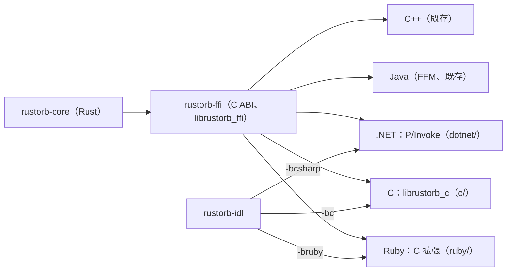

# .NET・C・Ruby の言語マッピング 計画書

Nov 21, 2026

計画 [#176](https://github.com/rustorb/rustorb/issues/176)（sub-issue は着手順に .NET の [#177](https://github.com/rustorb/rustorb/issues/177) ランタイム・[#178](https://github.com/rustorb/rustorb/issues/178) 生成器・[#179](https://github.com/rustorb/rustorb/issues/179) 相互接続、C の [#180](https://github.com/rustorb/rustorb/issues/180)・[#181](https://github.com/rustorb/rustorb/issues/181)・[#182](https://github.com/rustorb/rustorb/issues/182)、Ruby の [#183](https://github.com/rustorb/rustorb/issues/183)・[#184](https://github.com/rustorb/rustorb/issues/184)・[#185](https://github.com/rustorb/rustorb/issues/185)、追加機能の [#186](https://github.com/rustorb/rustorb/issues/186)〜[#188](https://github.com/rustorb/rustorb/issues/188)、リリースの [#189](https://github.com/rustorb/rustorb/issues/189)）。rustorb に、OMG の正式な言語マッピングに沿った .NET（C#）・C・Ruby のバインディングを足す。順序は .NET → C → Ruby。どれも Rust コアの `extern "C"` の安定 ABI（`crates/rustorb-ffi`、`rustorb.h`）の上に載せ、生成器は rustorb-idl に `-bcsharp`・`-bc`・`-bruby` として足す。この文書は実装の前に書いた計画で、実装で変えたところは各節を直す。

根拠は各言語マッピングの仕様書と CORBA 3.x の仕様だけで、既存の ORB（omniORB、IIOP.NET、Remoting.Corba、R2CORBA / TAO、ORBit など）のソースは読まない（[development-plan.md](development-plan.md) の方針）。相互接続は既存の interop CI（omniORB C++・omniORBpy・JacORB と rustorb の各バインディング）に新しい実装を足して確かめる。

## 準拠する仕様

| 言語 | 仕様 | 文書番号 | 備考 |
| --- | --- | --- | --- |
| C# | [IDL4 to C# Language Mapping 1.0](https://www.omg.org/spec/IDL4-CSHARP/1.0/) | formal/21-07-01 | データ型・インターフェース・valuetype の写し方（7章、8章 `@csharp_mapping`）と、CORBA の写し方（附属書 A.1：`Corba.UserException`・`Corba.TypeCode`・`Corba.Object` / `Corba.IObject`・`Corba.Any`） |
| C | [C Language Mapping 1.0](https://www.omg.org/spec/C/1.0/) | June 1999 edition | CORBA 2.x の C マッピング。POA のサーバント（EPV / VEPV）と DSI を含む。valuetype はない |
| Ruby | [Ruby CORBA Language Mapping 1.2](https://www.omg.org/spec/RCLM/1.2/) | formal/2013-04-05 | CORBA 3.1 に合わせたもの。POA のサーバント、DII / DSI、valuetype を含む |

仕様が決めていないところ（下の各節の「仕様にないところ」）は、rustorb の他のバインディング（C++・Java・Python）の振る舞いに揃え、各言語の設計書に「rustorb の拡張」と書く。

## 全体の構成

| 場所 | 内容 | ライセンス |
| --- | --- | --- |
| `dotnet/` | .NET のランタイム（アセンブリ `Rustorb.Corba`、名前空間 `Corba`・`PortableServer`・`CosNaming`・`Omg.Types`）、P/Invoke の層（`rustorb.h` から生成）、テスト（xUnit）、NuGet パッケージ `Rustorb` | MIT OR Apache-2.0 |
| `c/` | C のランタイム（`librustorb_c`、ヘッダ `<rustorb/orb.h>` など。C で書き、`rustorb.h` を呼ぶ）、CMake、テスト | MIT OR Apache-2.0 |
| `ruby/` | Ruby の gem `rustorb`（Ruby のランタイムと、`rustorb.h` を呼ぶ C 拡張 `rustorb_ext`）、テスト（minitest） | MIT OR Apache-2.0 |
| rustorb-idl の `csharp_backend.py`・`c_backend.py`・`ruby_backend.py` | 生成器 | GPL-3.0-or-later（生成物は対象外） |
| `interop/impls/rustorbcs`・`rustorbc`・`rustorbrb` | 相互接続用のクライアント・サーバー | MIT OR Apache-2.0 |

C ABI は既存のもので足りる見込みで、足りないものが出たら ABI の版（`RORB_ABI_VERSION`）を上げて足す。

## .NET（C#）

### 方針

- **FFI**：.NET 8（LTS）以降。`[LibraryImport]`（ソース生成の P/Invoke）で `librustorb_ffi` を呼び、コールバックは関数ポインタと `[UnmanagedCallersOnly]` の static メソッドにする（Java の FFM の `Native`・`Upcalls` と同じ形）。P/Invoke の宣言は `dotnet/tools/gen-pinvoke.py` が `rustorb.h` から作り、CI で `--check` する（Java の `gen-ffi.py` と同じ）
- **命名**：既定は仕様の「IDL の命名」（7.1.1.1。名前を変えない）。附属書 A が `Corba` の型に IDL の命名を求めていて、生成コードとランタイムの見た目が揃うため。`-Wbdotnet_naming`（`@csharp_mapping(apply_naming_convention=DOTNET_NAMING_CONVENTION)` と同じ）で .NET の命名（Pascal / Camel Case）にもできる。C# の予約語と同じ名前には `@`、仕様が使う名前（`Constants` など）と同じ名前には `_` を付ける
- **ハンドル**：C ABI のハンドルは `SafeHandle` の派生で持ち、GC で解放する
- **スレッド**：アップコール用スレッドプールのスレッドが upcall を呼ぶと、.NET のランタイムがそのスレッドを受け入れる。例外は upcall の外に出さず、C ABI の状態に直す

### 写し方（仕様のとおり）

| IDL | C# |
| --- | --- |
| `module` | `namespace` |
| 基本型 | `short`・`ushort`・`int`・`uint`・`long`・`ulong`・`float`・`double`・`bool`・`byte`（octet）・`char`（char と wchar）・`sbyte`（int8） |
| `long double` | `decimal`（仕様のとおり。他の言語との間で精度が変わる。[long-double.md](long-double.md)） |
| `fixed<D, S>` | `decimal`。範囲外は `System.ArithmeticException` |
| `string`・`wstring` | `string` |
| `sequence<T>` | `Omg.Types.ISequence<T>`（`IList<T>` の派生。実装は `Omg.Types.Sequence<T>`） |
| 配列 | `T[]`（多次元は `T[,]` ではなく仕様の例どおり入れ子）。長さの違いは `ArgumentOutOfRangeException` |
| struct | `public class`（`IEquatable<T>`、メンバーはプロパティ、既定・複製・全メンバーのコンストラクタ）。`@csharp_mapping(struct_type="struct")` で `struct` |
| union | `public class`。`Discriminator`、メンバーのプロパティ（選ばれていなければ `InvalidOperationException`）、`Set<Member>(value, discriminator)` |
| enum | `public enum`（`@bit_bound` で基底の型） |
| typedef | 元の型に置き換える（型は作らない） |
| 定数 | 各スコープの `public static partial class Constants`（`constants_container` で変えられる） |
| 例外 | `Corba.UserException`（`System.Exception` の派生）の派生クラス |
| インターフェース | `I<Name>Operations`・`I<Name> : Corba.IObject, I<Name>Operations`・`class <Name> : Corba.Object`（中の型と定数）。`in` は値、`out` は `out`、`inout` は `ref`。属性はプロパティ |
| `any`・`TypeCode` | `Corba.Any`（`insert_long` / `extract_long` などの対）、`Corba.TypeCode`（`kind()`、`id()` など。`Bounds`・`BadKind`） |
| valuetype | `public abstract class`（private のメンバーは `protected`、ファクトリは `[Omg.Types.Factory]`） |

### 仕様にないところ（rustorb が決める）

附属書 A はオブジェクト参照の中身、スタブ・スケルトン、サーバント、ORB の API、システム例外を決めていない。CORBA の PIDL を IDL の命名でそのまま写し、形は IDL to Java の CORBA の API に揃える。

- **ORB**：`Corba.ORB.init(string[] args)`、`resolve_initial_references`、`object_to_string` / `string_to_object`、`run`・`shutdown`・`destroy`
- **システム例外**：`Corba.SystemException : System.Exception`（`minor`・`completed`）と、その派生の `Corba.BAD_PARAM`・`Corba.TRANSIENT` など40種
- **参照**：`Corba.Object` がオブジェクト参照で、nil は `null`。`<Name>Helper.narrow(obj)` / `unchecked_narrow`、`_is_a`・`_non_existent`・`_is_equivalent`・`_hash` など
- **Any の残り**：仕様の `insert_` / `extract_` にない `string`・`wstring`・`fixed`・`long double`・TypeCode を足し、ユーザー定義の型は生成する `<Name>Helper` の `insert`・`extract`・`type`・`id`（Java と同じ形）
- **サーバント**：`abstract class <Name>POA : PortableServer.Servant, I<Name>Operations`。`_this()`、`_default_POA()`。POA と POAManager は `PortableServer.POA` などに PIDL を写す
- **`raises`**：仕様に C# の書き方がないので、XML の doc コメント（`<exception cref="...">`）に書く

## C

実装の結果は [c-binding.md](c-binding.md)。fixed の演算、DSI、`CORBA_exception_as_any` は #187 に回した。

### 方針

- **ランタイム**：`c/` の `librustorb_c`（静的ライブラリ。共有ライブラリ版は #187）。C99 で書き、`rustorb.h` を呼ぶ。ヘッダは `<rustorb/orb.h>`（`CORBA_*` の型と関数）と `<rustorb/poa.h>`（`PortableServer_*`）。CMake の `rustorb_idl_generate()` は C++ と同じ形
- **型の記述子**：生成コードは型ごとに、TypeCode と C の配置（`sizeof`・`offsetof`）を持つ記述子を出す。ランタイムの1つの汎用の読み書き・解放の処理がそれを辿るので、スタブ・スケルトン・`CORBA_any`・`CORBA_free` を1つの仕組みで扱える
- **`CORBA_free`**：ランタイムの確保（`T__alloc`、`CORBA_string_alloc`、`CORBA_sequence_T_allocbuf` など）は、確保した領域の前に記述子を指す見出しを置き、`CORBA_free` はそれを見て中の領域（列の文字列、参照など）まで解放する

### 写し方（仕様のとおり）

| IDL | C |
| --- | --- |
| 名前 | スコープ付きの名前の `::` を `_` に（`Mod_Iface_op`） |
| 基本型 | `CORBA_short`・`CORBA_long`・`CORBA_long_long`・`CORBA_unsigned_*`・`CORBA_float`・`CORBA_double`・`CORBA_long_double`・`CORBA_char`・`CORBA_wchar`・`CORBA_boolean`・`CORBA_octet` |
| `string`・`wstring` | `CORBA_char*`・`CORBA_wchar*`（`CORBA_string_alloc`・`CORBA_wstring_alloc`） |
| `fixed<D, S>` | `CORBA_fixed_D_S`（`_digits`・`_scale`・`_value[]`） |
| `sequence<T>` | `_maximum`・`_length`・`_buffer` の構造体（`CORBA_sequence_T`）、`CORBA_sequence_T_allocbuf`、`CORBA_sequence_set_release` / `get_release` |
| 配列 | C の配列と `T_slice`、`T__alloc` |
| struct・union | C の構造体。union は `_d` と `_u` |
| enum・定数 | 列挙子と定数は `#define` |
| 例外 | 構造体、`ex_<名前>`（リポジトリ ID）、`<名前>__alloc` |
| `any` | `CORBA_any`（`_type`・`_value`）、`CORBA_any_alloc`、`CORBA_any_set_release` |
| インターフェース | `typedef CORBA_Object Mod_Iface;`、スタブ `Mod_Iface_op(obj, 引数..., CORBA_Environment* ev)`、属性は `Mod_Iface__get_x` / `__set_x` |
| 例外の受け渡し | `CORBA_Environment`（`_major` が `CORBA_NO_EXCEPTION`・`CORBA_USER_EXCEPTION`・`CORBA_SYSTEM_EXCEPTION`）、`CORBA_exception_id` / `_value` / `_free` / `_set` / `_as_any` |
| 引数と結果 | 仕様の表 1-2・1-3 のとおり（可変長の `out` と結果は呼ばれた側が確保し、呼んだ側が `CORBA_free`） |
| サーバント | `PortableServer_ServantBase`、`POA_Mod_Iface`・`POA_Mod_Iface__epv`・`POA_Mod_Iface__vepv`（`_base_epv` が先頭）、`POA_Mod_Iface__init` / `__fini`。実装の関数は `(PortableServer_Servant _servant, 引数..., CORBA_Environment* _env)` |
| DSI | `PortableServer_DynamicImpl`、`CORBA_ServerRequest_*` |
| ORB | `CORBA_ORB_init(int* argc, char** argv, CORBA_ORBid, CORBA_Environment*)`、`CORBA_ORB_object_to_string` など |

### 仕様にないところ（rustorb が決める）

- **ORB と POA の関数**：仕様は疑似オブジェクトの操作を `<インターフェース>_<操作>` で写すとだけ決めている。この規則で CORBA と PortableServer の PIDL を写す（`CORBA_Object_duplicate`・`CORBA_Object_release`・`CORBA_Object_is_nil`、`CORBA_ORB_resolve_initial_references`、`PortableServer_POA_activate_object`、`PortableServer_POAManager_activate` など）
- **`CORBA_string_dup`**：仕様にはないが、他のマッピングにある便利な関数として足す（`CORBA_wstring_dup` も）
- **システム例外の値**：`CORBA_exception_value` が返すのは `CORBA_SystemException`（`minor`・`completed`）の構造体。リポジトリ ID は `ex_CORBA_BAD_PARAM` など
- **`wchar`**：`CORBA_wchar` は 16 ビットの UTF-16 の単位（`wstring` も）。仕様の `L` の付いた文字列定数は `wchar_t` が 16 ビットの環境でだけそのまま使える
- **valuetype・abstract interface**：C マッピングにないので、`-bc` はエラーにする

## Ruby

### 方針

- **ランタイム**：gem `rustorb`（Ruby 3.0 以降）。`rustorb.h` を呼ぶ C 拡張 `rustorb_ext` と、その上の Ruby のコード（`CORBA`・`PortableServer`・`CosNaming`）。Fiddle（標準の FFI）は、アップコール用スレッドから Ruby を呼ぶとき（GVL の取得）を自分で扱えないので使わない。C 拡張はアップコール用スレッドから `rb_thread_call_with_gvl` で Ruby に入る
- **生成物の配置**：仕様は決めていない。`Foo.idl` から `FooC.rb`（型・スタブ）と `FooS.rb`（スケルトン、`FooC.rb` を読む）を出す

### 写し方（仕様のとおり）

| IDL | Ruby |
| --- | --- |
| 名前 | モジュール・インターフェース・定数は先頭を大文字、操作と属性は先頭を小文字。予約語は `r_` / `R_`、組み込みクラスの名前は `R_`、`Object` のメソッドの名前は `r_` |
| 整数・浮動小数点 | `Integer`・`Float`。`long double` は `CORBA::LongDouble` |
| `boolean`・`char`・`wchar` | `true` / `false`、1文字の `String`（または `Integer`）、`Integer` |
| `string`・`wstring` | `String`、`Integer` の `Array`（`in` / `inout` は `String` も受ける） |
| `sequence`・配列 | `Array`（octet と char の列は `in` / `inout` で `String` も受ける） |
| struct・例外 | `attr_accessor` と位置引数の `initialize` を持つクラス。例外は `CORBA::UserException` の派生 |
| union | `_disc`・`_disc=`・`_is_at_default?`・メンバーの読み書き。default の判別子は `:default` |
| enum | 列挙子は整数の定数、型名のクラスに `_tc` |
| `any`・TypeCode | `CORBA::Any.to_any(value, tc)`、`CORBA._tc_long` など、定義した型の `Type._tc` |
| インターフェース | モジュール（mixin）と `Iface._narrow(obj)`、nil は `nil`。`out` / `inout` は結果の配列で返す（`name, age = obj.get_data`）。属性は `obj.x` / `obj.x = v` |
| サーバント | `POA::Mod::Iface` を継承するクラス、`_this`・`_default_POA` |
| DSI | `PortableServer::DynamicImplementation`（`invoke`・`_primary_interface`） |
| ORB | `CORBA.ORB_init(args, orb_id)`、`orb.run`・`orb.shutdown` など |
| 送受信できない値 | 範囲外の整数や上限を超えた列は `CORBA::MARSHAL`（仕様のとおり。他のバインディングは送信時 `BAD_PARAM`） |

### 仕様にないところ（rustorb が決める）

- **`fixed`**：仕様は「対応しない」とする。rustorb は `BigDecimal` で扱う（拡張。Python・Java と同じく丸めない）
- **システム例外の `completed`**：仕様に値がないので `CORBA::COMPLETED_YES` / `COMPLETED_NO` / `COMPLETED_MAYBE` の定数を置く

実装の結果は [ruby-binding.md](ruby-binding.md)。生成コードはどの名前も `::` から書くので、組み込みクラスと同じ名前（`String` など）は `R_` を付けずにそのまま使う。DSI は #188 に回した。

## 範囲

最初の段（各言語の3つの sub-issue）で入れるもの：

- IDL のデータ型すべて（`any`・TypeCode・`fixed`・再帰型を含む）、インターフェース（継承、属性、oneway）、ユーザー例外とシステム例外
- ORB（`ORB_init` と `-ORB*` のオプション、初期参照、`corbaloc:` / `corbaname:`、`run` / `shutdown`）、POA（`create_POA` と7種のポリシー、活性化、参照の変換、POAManager）、`PortableServer::Current`
- CosNaming のスタブ（rustorb-idl の `CosNaming.idl` から生成してランタイムに同梱）

後の段（各言語の「追加機能」の sub-issue）に回すもの：

| 機能 | .NET | C | Ruby |
| --- | --- | --- | --- |
| valuetype・value box・abstract interface | 入れる | 仕様にない（入れない） | 入れる |
| DII / DSI | 入れる | DSI は仕様にある。DII も入れる | 入れる |
| servant manager・adapter activator | 入れる | 入れる | 入れる |
| callback AMI（`-Wbami`） | 入れる | 入れる | 入れる |
| Portable Interceptors | 入れる | 入れる | 入れる |
| DynAny | 入れる | 入れる | 入れる |

## 試験と相互接続

- **各言語の単体の試験**：C++ の `cpp/tests/idl/CxxMapping.idl` と同じ範囲の IDL で、生成コードの形と ORB 内の呼び出しを確かめる。CI（ci.yml）に `dotnet`（Linux・macOS・Windows）、`c`（Linux・macOS、gcc / clang、ASan / LSan）、`ruby`（Linux・macOS）のジョブを足す
- **生成器の試験**：rustorb-idl の `python/tests/test_csharp_backend.py` などで、生成したコードを `dotnet build`・`cc -fsyntax-only`・`ruby -c` で確かめる（道具がなければ飛ばす）
- **相互接続**：`interop/impls/rustorbcs`・`rustorbc`・`rustorbrb` に Echo のサーバーとクライアントを置き、`run-matrix.sh`（basic と any の組）、`run-naming-check.sh`、`run-wire-probe.sh`、`run-poa-probe.sh` に足す。相手は omniORB C++・omniORBpy・JacORB・rustorb の各バインディング。相互接続のイメージに .NET SDK 8 と Ruby を入れる。追加機能の段では value・abstract・custom の組と各 probe（AMI・PI・DynAny）に足す

## 順序（sub-issue の並び）

| 段 | 内容 | リポジトリ | 依存 |
| --- | --- | --- | --- |
| 1 | .NET：ランタイム（`dotnet/`、P/Invoke、`Corba`・`PortableServer`・`CosNaming`）と CI（#177） | rustorb | なし |
| 1 | .NET：`-bcsharp`（#178） | rustorb-idl | なし（ランタイムと並行。ランタイムの CI は生成器のコミットに固定する） |
| 2 | .NET：相互接続（`rustorbcs`）と設計書 `docs/csharp-binding.md`（#179） | rustorb | 1 |
| 3 | C：ランタイム（`c/`、`librustorb_c`）と CI（#180） | rustorb | なし |
| 3 | C：`-bc`（#181） | rustorb-idl | なし |
| 4 | C：相互接続（`rustorbc`）と設計書 `docs/c-binding.md`（#182） | rustorb | 3 |
| 5 | Ruby：ランタイム（gem `rustorb` と C 拡張）と CI（#183） | rustorb | なし |
| 5 | Ruby：`-bruby`（#184） | rustorb-idl | なし |
| 6 | Ruby：相互接続（`rustorbrb`）と設計書 `docs/ruby-binding.md`（#185） | rustorb | 5 |
| 7 | 追加機能：.NET・C・Ruby（言語ごとに1つ）（#186〜#188） | 両方 | 2・4・6 |
| 8 | リリース：rustorb 0.7.0・rustorb-idl 0.5.0、NuGet と RubyGems、docs サイト（EN / JA）（#189） | 全部 | 7 |

C と Ruby は .NET の段に依存しないので、.NET の PR のレビュー待ちの間に始めてよい。

## 決めたこと（推奨で進める。変えるなら計画の issue か各 PR で）

1. **C# の命名**：既定は IDL の命名。`-Wbdotnet_naming` で .NET の命名も選べる
2. **.NET の下限**：.NET 8（`LibraryImport` と `UnmanagedCallersOnly` のため。.NET Standard 2.0 / .NET Framework は対象外）
3. **C# の ORB の API**：仕様にないので、PIDL を IDL の命名で写し、形は IDL to Java に揃える
4. **C のランタイム**：C で書いた `librustorb_c` と、生成する型の記述子による汎用の読み書き
5. **C の valuetype**：仕様にないので `-bc` はエラーにする
6. **Ruby の FFI**：C 拡張（Fiddle は使わない）。生成物は `FooC.rb` / `FooS.rb`
7. **Ruby の `fixed`**：`BigDecimal` で扱う（仕様は対応しない。rustorb の拡張）
8. **範囲**：最初の段はデータ型・インターフェース・例外・ORB・POA・CosNaming。valuetype・DII / DSI・servant manager・AMI・PI・DynAny は追加機能の段
9. **配布**：.NET は NuGet の `Rustorb`（`runtimes/<rid>/native` に各 OS の `librustorb_ffi`）、Ruby は RubyGems の `rustorb`（インストール時に C 拡張をビルドし、`librustorb_ffi` は gem に入れたものか `RUSTORB_FFI_LIBRARY`）、C は Release の tar（ヘッダ・ライブラリ・CMake のパッケージ）。NuGet と RubyGems の公開の鍵はユーザーが設定する
